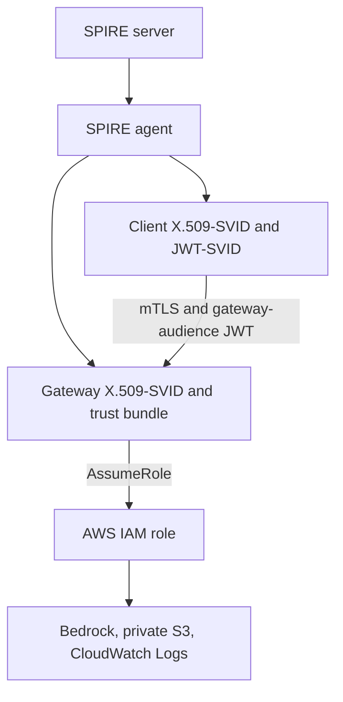

# Secure Bedrock Evaluation Gateway

A TypeScript gateway for comparing support-ticket classification prompts through Amazon Bedrock. SPIRE provides client and gateway workload identities. The gateway assumes a scoped AWS IAM role to invoke Bedrock, store sanitized evidence in private S3, and publish operational events to CloudWatch Logs. Terraform and Terragrunt manage the AWS resources in `live/dev`.

## Request and trust flow



The TLS handshake verifies the certificate chain. The gateway also requires the client's exact SPIFFE ID, validates the JWT audience and expiry, and permits only `spiffe://secure-bedrock-evaluation-gateway.local/client`. The client checks the gateway's SPIFFE ID. SPIFFE establishes workload identity; the separate IAM role controls AWS permissions. JWT authorization alone is not proof of mTLS.

`src/gateway.ts` serves `/authorize` and `/tickets` over HTTPS. It uses the non-streaming Bedrock Converse API, validates the three-field JSON output, writes only validated classification evidence to S3, and emits CloudWatch events without ticket text, model response text, or credentials. The gateway applies replacement SPIRE X.509-SVIDs to new TLS connections; the client fetches current TLS material for each request.

## Deployment and operator runbook

The development stack uses the pins in `.terraform-version`, `.terragrunt-version`, `.nvmrc`, `package-lock.json`, `live/dev/.terraform.lock.hcl`, and `images.lock.env`. Keep the local SPIRE join token, bootstrap trust bundle, AWS credentials, Terraform state, and detailed evaluation results out of Git. Preserve state and SPIRE volumes until evidence review and teardown are complete.

For an existing deployment, export the same AWS operator identity and deployed outputs used when the gateway was started. From the repository root:

```bash
export GATEWAY_ROLE_ARN="$(cd live/dev && terragrunt output -raw gateway_role_arn)"
export BEDROCK_MODEL_ID="$(cd live/dev && terragrunt output -raw model_id)"
export EVIDENCE_BUCKET_NAME="$(cd live/dev && terragrunt output -raw bucket_name)"
export CLOUDWATCH_LOG_GROUP_NAME="$(cd live/dev && terragrunt output -raw log_group_name)"
docker compose --env-file images.lock.env config --quiet
docker compose --env-file images.lock.env up -d --wait gateway
docker compose --env-file images.lock.env run --rm -T client
```

The gateway defaults to V2 through Compose. An unsupported `PROMPT_ID` fails startup. `docs/verification/sanitized/release-approval.json` records the reviewed V2 prompt and dataset hashes, but gateway startup does not enforce the approval manifest or hashes. Verify them before changing the deployed prompt. To recover from a bad Compose override, remove the override, run `docker compose --env-file images.lock.env up -d --wait --force-recreate gateway`, then verify authorization. Do not use `apply` merely to check consistency.

For final application and infrastructure checks:

```bash
npm run typecheck && npm test
terraform -chdir=modules/evaluation-foundation fmt -check -recursive
(cd live/dev && terragrunt run validate && terragrunt run plan)
```

Run the plan against the actual deployed inputs and backend. A no-change plan verifies infrastructure consistency, not application correctness. Preserve local state before Sunday's review and teardown; remove AWS resources through Terragrunt only after retaining required artifacts and versions.

## Evaluation, controls, and tradeoffs

The five development cases are separate from the 20 frozen cases. Both prompts used the same frozen dataset. V1 scored 18/20 schema-valid, 18/20 correct categories, and 17/20 factual summaries, so it failed the unchanged 18/17/18 gate. V2 scored 20/20, 18/20, and 20/20 and is the reviewed choice. The report also covers urgency, latency, tokens, estimated inference cost, retries, and per-case adjudication. Factuality differs from complete coverage of every requested detail.

- [Frozen prompt comparison](docs/verification/sanitized/prompt-comparison.md)
- [First sanitized Bedrock invocation](docs/verification/sanitized/first-bedrock-invocation.json)
- [Identity, release, and recovery evidence](docs/verification/sanitized/identity-release-evidence.md)
- [Release approval](docs/verification/sanitized/release-approval.json)

The IAM policy scopes model invocation to one foundation model, S3 writes to an evidence prefix, and CloudWatch writes to one stream. The S3 bucket has versioning, lifecycle retention, public-access blocking, HTTPS-only access, and SSE-S3 default encryption; this project does not configure customer-managed KMS encryption. The gateway limits ticket bodies to 4 KiB and model output to 160 tokens. These are lab cost and exposure controls, not a production cost guarantee.
